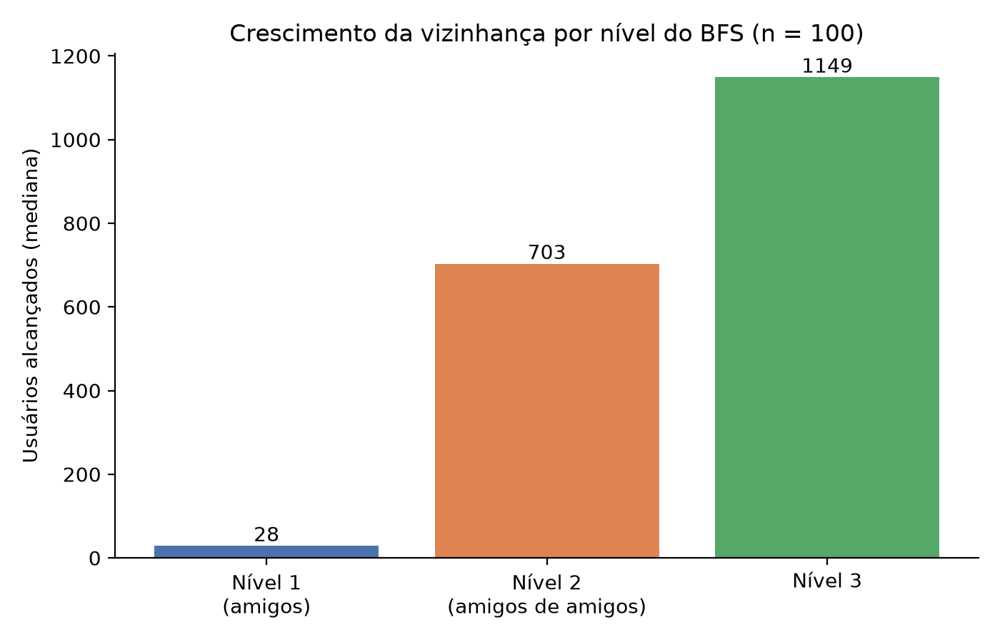
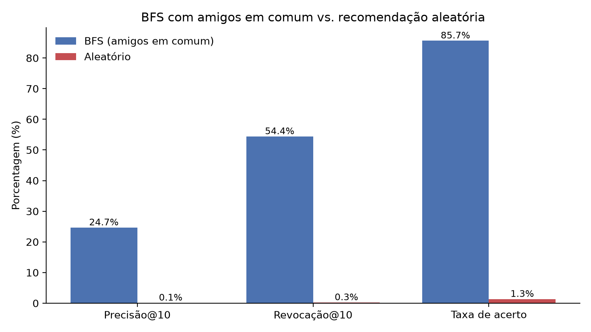

# BFS na recomendação de conexões em redes sociais

Experimento do artigo **"A utilização do algoritmo BFS (Busca em Largura) pelas redes sociais para identificar e recomendar conexões entre pessoas próximas"**, desenvolvido no curso de Engenharia de Software da Universidade da Região de Joinville (Univille), Campus São Bento do Sul.

O projeto implementa o algoritmo BFS em Python, com uma adaptação que conta **amigos em comum**, e avalia o seu comportamento em uma rede social real: o conjunto **ego-Facebook**, com 4.039 usuários e 88.234 amizades.

## Principais resultados

**Experimento 1: crescimento da vizinhança por nível** (100 usuários sorteados)

| | Nível 1 | Nível 2 | Nível 3 |
|---|---|---|---|
| Mediana de usuários alcançados | 28,5 | 703 | 1.149 |
| % da rede alcançada (acumulado) | 0,7% | 19,4% | 45,3% |

Do nível 1 para o nível 2, a vizinhança de um usuário típico cresce cerca de **18 vezes**.

**Experimento 2: validação das recomendações** (10% das amizades escondidas, top 10, média de 5 repetições)

| Métrica | BFS (amigos em comum) | Aleatório |
|---|---|---|
| Precisão@10 | 24,68% ± 0,22 | 0,14% ± 0,01 |
| Revocação@10 | 54,42% ± 0,35 | 0,25% ± 0,06 |
| Taxa de acerto | 85,65% ± 0,76 | 1,35% ± 0,10 |

A recomendação por amigos em comum foi **181 vezes mais precisa** que a escolha aleatória.





## Estrutura do projeto

```
experimento-bfs/
├── bfs.py                      # BFS clássico e BFS adaptado (amigos em comum)
├── experimento1_niveis.py      # Experimento 1: usuários alcançados por nível
├── experimento2_validacao.py   # Experimento 2: validação das recomendações
├── requirements.txt            # Bibliotecas necessárias
├── dados/                      # Coloque aqui o dataset (não incluído no repositório)
└── resultados/                 # Tabelas (.csv) e gráficos (.png) gerados
```

## Como executar

### 1. Instalar as dependências

Requer Python 3.9 ou superior (o experimento foi executado com Python 3.12.9).

```bash
pip install -r requirements.txt
```

### 2. Baixar o dataset

1. Acesse https://snap.stanford.edu/data/ego-Facebook.html
2. Baixe o arquivo `facebook_combined.txt.gz`
3. Coloque-o na pasta `dados/`, **sem descompactar**

### 3. Testar com o exemplo do artigo

```bash
python bfs.py
```

A saída deve recomendar Eve (2 amigos em comum) e Dave (1 amigo em comum) para Alice.

### 4. Rodar os experimentos

```bash
python experimento1_niveis.py
python experimento2_validacao.py
```

Os resultados são salvos na pasta `resultados/`. As sementes aleatórias são fixas (42 a 46), então uma nova execução reproduz exatamente os mesmos números.

## Metodologia resumida

- **Experimento 1:** sorteia 100 usuários e executa o BFS até o nível 3, contando os usuários em cada nível e medindo o tempo. Antes, valida a implementação comparando as distâncias com as da biblioteca NetworkX.
- **Experimento 2:** remove aleatoriamente 10% das amizades, gera as 10 melhores recomendações de cada usuário pelo BFS e verifica quantas amizades removidas foram recuperadas, comparando com recomendações aleatórias. Segue o método de *link prediction* de Liben-Nowell e Kleinberg (2007).

## Limitações

- O ego-Facebook é pequeno e muito agrupado, o que favorece o BFS; em redes maiores os números tendem a ser menores.
- A remoção aleatória de amizades simula, mas não substitui, a previsão de amizades futuras.
- As conexões não têm peso, e os tempos foram medidos em uma única máquina.

## Dataset

LESKOVEC, Jure; KREVL, Andrej. **SNAP Datasets**: Stanford Large Network Dataset Collection. 2014. Disponível em: https://snap.stanford.edu/data.

McAULEY, Julian; LESKOVEC, Jure. Learning to discover social circles in ego networks. *In*: ADVANCES IN NEURAL INFORMATION PROCESSING SYSTEMS, 25., 2012.

## Autores

- Gabrielly Pensak
- Kaue Marcelo Alves

Engenharia de Software, Universidade da Região de Joinville (Univille), Campus São Bento do Sul, 2026.
